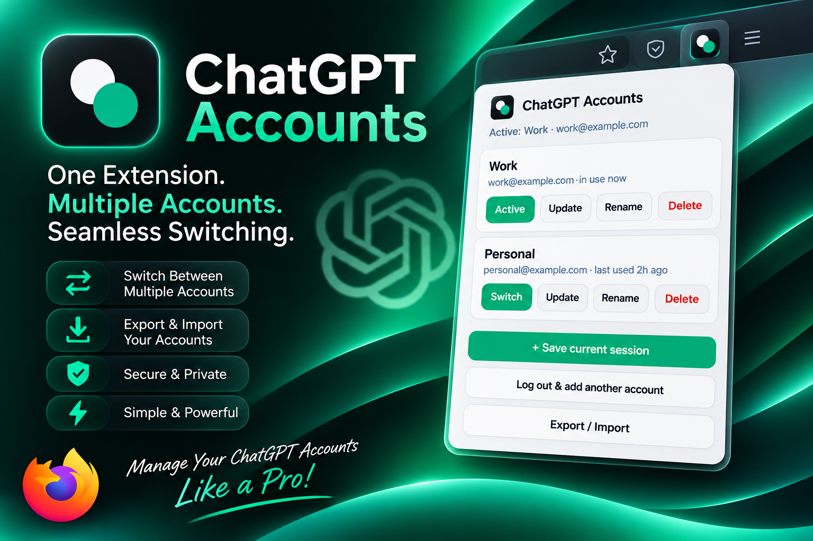
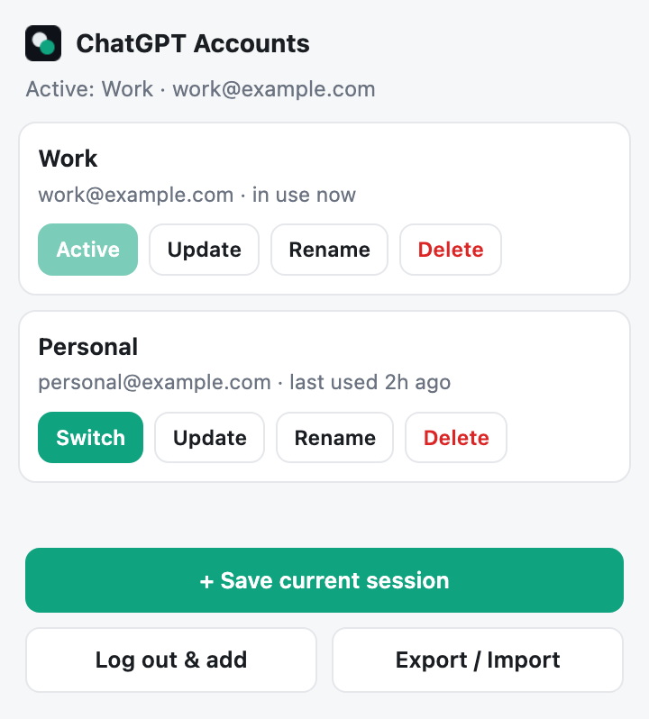
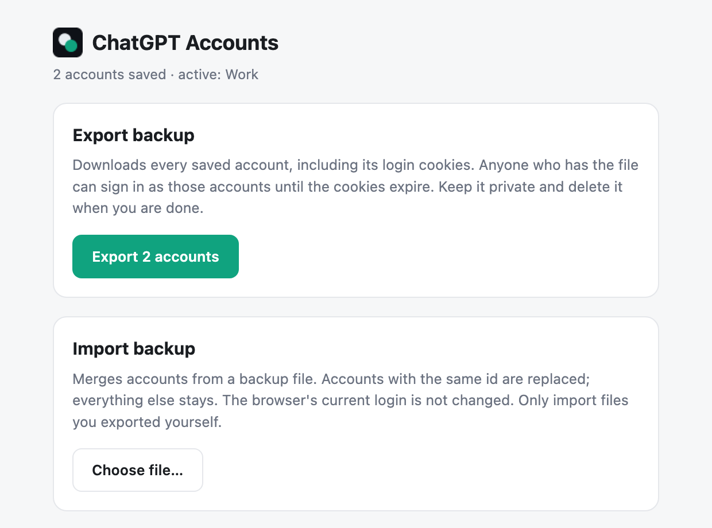

# ChatGPT Account Switcher

<p align="center">
  
</p>

<p align="center">
  <strong>Save several ChatGPT accounts in Firefox and switch between them in one click.</strong>
</p>

<p align="center">
  
  
  
  
  
  
</p>

ChatGPT Account Switcher stores a local snapshot of each account's
`chatgpt.com` / `openai.com` cookies. Switching restores the selected snapshot
and reloads your ChatGPT tabs, so each account stays signed in without a fresh
login every time.

It runs entirely in your browser: no server, no analytics, no third-party code.

> **Status:** `v1.0.0` has been submitted to AMO for review. Until the listing
> is approved, install from source or use a signed unlisted build.

## Features

- **One-click account switching** — restore a saved session and reload every
  `chatgpt.com` tab.
- **Never lose an unsaved login** — the current session is snapshotted before a
  switch, and the add-on refuses to clear a live session it cannot attribute to
  a saved account.
- **Add as many accounts as you need** — a built-in *Log out & add another
  account* button clears the browser session while keeping your snapshots.
- **Last-used history** — accounts are sorted by recent use and show
  `in use now`, `last used 2h ago`, etc.
- **Update, rename, delete** — refresh a snapshot after an auth change, keep
  your own labels, or remove an account without touching the live session.
- **Export / import** — move accounts between Firefox profiles or keep an
  offline backup as a JSON file.
- **Minimal permissions** — `cookies`, `storage`, and `tabs`, with host access
  limited to `chatgpt.com` and `openai.com`.
- **Light and dark UI** that follows Firefox's theme.

## Install

### Try it from source

Requires Firefox 115 or newer.

```bash
git clone https://github.com/tje3d/chatgpt-account-switcher.git
cd chatgpt-account-switcher
npm test
npm run build
```

Then:

1. Open `about:debugging#/runtime/this-firefox`.
2. Click **Load Temporary Add-on…**.
3. Select `extension/manifest.json`.

Temporary add-ons are removed when Firefox restarts.

### Permanent install (signed `.xpi`)

Firefox only installs permanently from a signed package. Create an AMO account,
then generate API credentials at
<https://addons.mozilla.org/developers/addon/api/key/>.

```bash
npm run build
npx web-ext sign \
  --source-dir extension \
  --artifacts-dir signed \
  --channel unlisted \
  --api-key "$AMO_JWT_ISSUER" \
  --api-secret "$AMO_JWT_SECRET"
```

Install the resulting `.xpi` from `about:addons` → gear icon → **Install Add-on
From File…**. Firefox keeps it across restarts.

A signed build will be linked here once the AMO listing is available.

## Usage

<p align="center">
  
</p>

### Save your first account

1. Sign in to <https://chatgpt.com>.
2. Click the toolbar icon.
3. Press **+ Save current session** and give it a name, such as `Work`.

### Add another account

1. Press **Log out & add another account**.
   This clears the browser's ChatGPT cookies but keeps every saved snapshot.
2. Sign in to ChatGPT with the second account.
3. Open the popup and press **+ Save current session** again.

Signing out through ChatGPT's own menu works too; the button is just faster and
guarantees that the saved snapshots stay untouched.

### Switch accounts

Press **Switch** on any row. The add-on snapshots the live session, restores the
target cookies, reloads all ChatGPT tabs, and marks the account as active. The
list shows last-used times so you can see which account was used when.

- **Update** replaces a row's snapshot with the session currently in the
  browser.
- **Rename** changes only the label.
- **Delete** removes the saved snapshot. It does not log you out of the live
  session.

If the browser session is signed in as an account that is not saved yet, the
add-on stops instead of silently destroying it. Save that session first.

## Export and import

<p align="center">
  
</p>

The **Export / Import** button in the popup opens a backup page in a new tab (a
file picker inside the popup would close the popup).

- **Export** downloads `chatgpt-accounts-YYYY-MM-DD.json` containing every saved
  account and its cookies.
- **Import** merges a backup into the current list. Accounts with the same id
  are replaced; other accounts stay. The current browser login is not changed.
  Invalid accounts and cookies outside `chatgpt.com` / `openai.com` are skipped.

> **Treat an export like a password.** Anyone with the file can sign in as those
> accounts until the cookies expire. Keep it private, do not upload it, and
> delete it when you are done.

## How switching works

1. Reads cookies for `chatgpt.com` and `openai.com` from Firefox's default
   cookie store.
2. Refreshes the active account's snapshot when the live jar still contains a
   ChatGPT session.
3. Clears those cookies in the default store.
4. Restores the target snapshot, preserving `secure`, `httpOnly`, `sameSite`,
   path, expiration, `firstPartyDomain`, partition information, and session
   cookies.
5. Reloads every `chatgpt.com` tab, or opens one if none is open.
6. Records the account as active and updates its last-used time.

If the restore fails completely, the previous jar is restored before the error
is reported.

### Cookie details

- `__Host-*` cookies are written without a `domain`, as required by browsers.
- Host-only cookies stay host-only instead of being widened to the whole
  domain.
- Session cookies remain session cookies; persistent cookies keep their
  expiration date.
- A jar without a session-token cookie is treated as logged out. This prevents
  anonymous cookies left by the ChatGPT login page from being mistaken for an
  unsaved account.

## Privacy and security

- All snapshots live in `browser.storage.local`. They are **not encrypted**.
  Anyone who can read your Firefox profile can read them, so do not use this on
  a shared machine.
- The add-on makes no network requests of its own except reading
  `https://chatgpt.com/api/auth/session` to display the active email address.
- No telemetry, no remote configuration, no third-party scripts.
- Cookie snapshots and exported backups are credentials. Delete accounts and
  backups you no longer need.
- Rapid switching can trigger Cloudflare or OpenAI security checks. Using
  multiple accounts to avoid rate limits may violate OpenAI's terms; use this
  for accounts you own.

The full policy is in [PRIVACY.md](PRIVACY.md).

## Limitations

- Only Firefox's **default cookie store** is handled. Tabs in Multi-Account
  Containers and private windows have separate cookie jars and are not switched;
  use normal windows.
- Snapshots cover `chatgpt.com` and `openai.com`, so switching also changes the
  OpenAI Platform session on `platform.openai.com`.
- If OpenAI changes its cookie-based authentication, saved snapshots may stop
  working. Sign in again and press **Update** to refresh them.
- Desktop Firefox only. Other browsers are not supported.

## Development

```bash
npm test        # 38 behaviour and integration tests
npm run lint    # web-ext lint
npm run build   # icons + extension/ → dist/chatgpt-account-switcher-1.0.0.xpi
npm start       # launch a temporary Firefox profile with the add-on
```

The tests use a `vm` sandbox and an in-memory browser mock, so they run without
Firefox or network access.

### Project layout

```
extension/
  manifest.json         Manifest V3 definition
  background.js         message router, badge, tab reloads
  lib/core.js           cookie snapshot engine and account manager
  popup/                toolbar UI
  backup/               export / import page (options page, opens in a tab)
  content/chatgpt.js    session email probe and switch toast
tests/
  core.test.js          cookie engine behaviour tests
  background.test.js    message-router integration tests
tools/
  make_icons.py         dependency-free PNG icon generator
  build.js              version-aware XPI packaging
docs/
  PUBLISHING.md         AMO signing and listing checklist
  screenshots/          README screenshots (demo data, no real accounts)
```

## Contributing

Issues and pull requests are welcome. Please run `npm test` and `npm run lint`
before submitting a change, and never attach real cookie exports or account
backups to an issue.

For security reports, see [SECURITY.md](SECURITY.md). The AMO release
checklist is in [docs/PUBLISHING.md](docs/PUBLISHING.md).

## License

[MIT](LICENSE) © 2026 Moein Porkamel

ChatGPT Account Switcher is an independent project and is not affiliated with
or endorsed by OpenAI or Mozilla.
